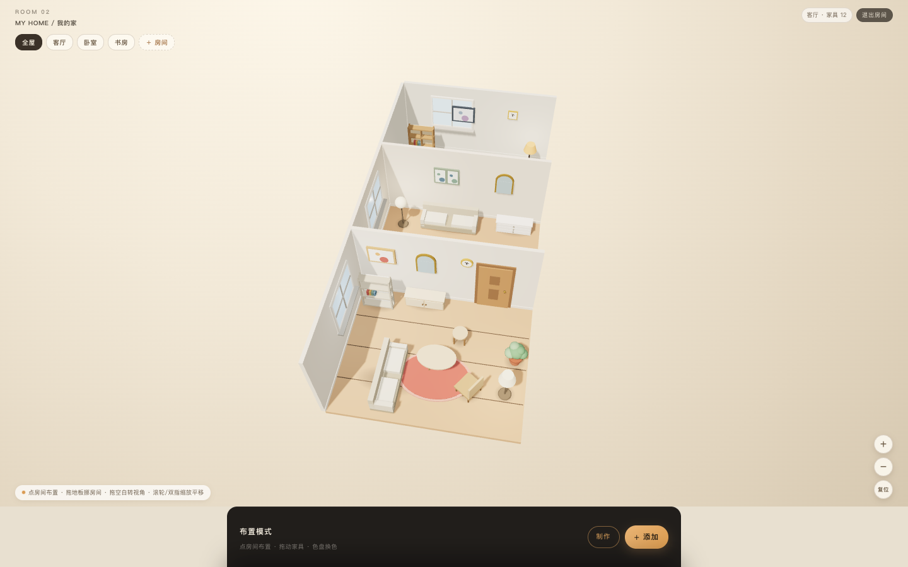
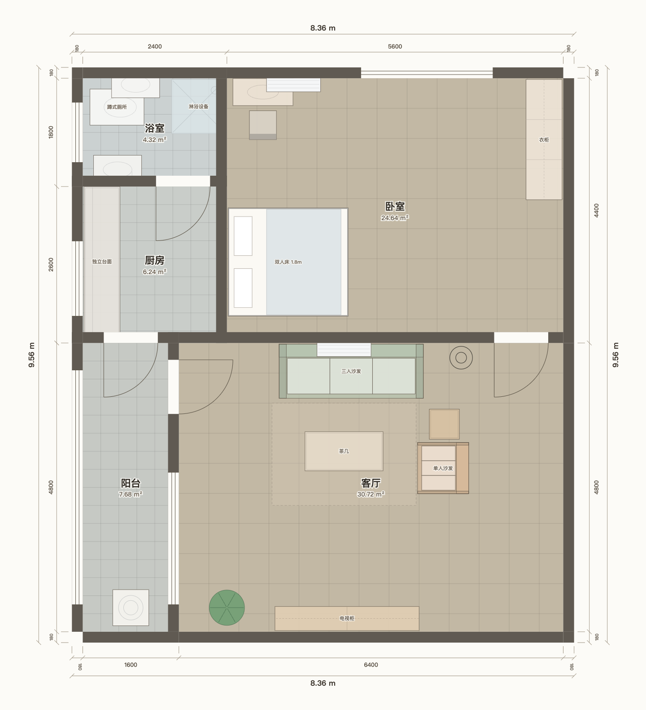

[简体中文](README.md) | English

# RoomCraft · 房间工坊

[](https://taro.zone/)
[](https://threejs.org/)
[](./LICENSE)

A 3D room layout mini-game demo built with **Taro + three.js**: it is bundled as an H5 web page while keeping the App (RN) build configuration. Start from an empty room, add rooms, change the floor plan, lay flooring, place furniture, recolor every item, craft a piece of furniture that is entirely your own, and finally export a 2D floor plan or a full PDF booklet.

All rooms, furniture, doors, windows, and materials are generated in real time by code, **with no reliance on any external images or copyrighted assets**.



<!-- 部署后替换成你的在线地址 -->
<!-- 在线体验：https://<username>.github.io/roomcraft/ -->

## Features

### Floor Plan & Rooms

- Multi-room floor plans: switch, add, rename, and delete rooms via the top tabs (deletion requires confirmation and at least one room is kept); when there are many rooms, the tab row scrolls horizontally.
- In the whole-home view, drag a room's floor to move the room directly: snapping to a 0.25 m grid, automatically sticking to the edge when near a neighbouring room, and springing back if released away from the main body.
- Room dimensions support the presets `6×4 / 8×6 / 9×7 / 10×5 / 12×8` or custom width / depth (1–20 m). After resizing, furniture is automatically pulled back inside the bounds, doors and windows that no longer fit are flagged and removed, and adjacent rooms give way and re-snap automatically.

### 3D Scene

- three.js + WebGL real-time rendering; push the door to enter from the lobby, and exit via the top-right corner.
- Orbit rotation, wheel / two-finger zoom, two-finger drag or right-click (`Shift` + drag) to pan; buttons on the right zoom and reset the view.
- Adaptive desktop and mobile layouts, with full touch-gesture support.
- Built-in Chinese / English UI: switch with the `EN / 中文` button in the top-right HUD. The preference is saved locally, and 2D floor plans and PDF exports follow the selected language.

### Decoration & Furniture

- Walls, floors, skirting boards, doors, and windows can all be selected and recolored; a unified 48-color palette automatically derives a full light/dark color set.
- Walls / floors support **plain, tile, and plank** finishes, with adjustable tile size and plank width.
- Doors and windows can slide along walls; width / height are adjusted in metres with sliders.
- Built-in [floorplan-3d](https://github.com/wy51ai/floorplan-3d) furniture library; furniture is automatically positioned per room.
- Furniture supports dragging, rotation on the X/Y/Z axes, and adjustment of width / depth / height above floor in metres, plus recoloring and deletion.
- Undo the last 30 operations.

### DIY Furniture Workshop

- Freely assemble a piece of furniture from boxes, cylinders, spheres, and cones, then adjust its size and color and name it.
- Creations are stored in `localStorage`, support export / import of a library share code, and can be accumulated and used across multiple pieces.

### Export & Sharing

- **Share code**: `MYHOME1:` + base64url(deflate(JSON)); falls back to uncompressed `MYHOME0:` if compression fails.
- **Share package**: a zip file containing the share-code text and a preview image; the recipient pastes the share code to restore the entire home.
- **2D floor plan**: includes room names and areas, furniture names, a door/window legend, and dimension chains on all four sides; output as both the share-package preview image and the first page of the PDF (PNG).
- **PDF scheme booklet**: 2D floor plan + 3D top-down view + one page of 3D panorama per room, powered by a built-in minimal PDF generator with no third-party PDF library.



## Tech Stack

| Category | Choice |
| --- | --- |
| Cross-platform framework | Taro 4.3.2 (React 18 + TypeScript) |
| 3D rendering | three.js 0.128 + WebGL |
| Compression / share code | fflate (pure JS deflate) |
| Styling | Sass |
| Build | Webpack 5 (built into Taro) |

## Quick Start

Requirements: Node.js 18+ (20 LTS recommended), npm 9+.

```bash
git clone https://github.com/<your-name>/roomcraft.git
cd roomcraft
npm install
npm run dev:h5
```

After starting, open <http://localhost:10086>.

## Available Commands

| Command | Description | Output |
| --- | --- | --- |
| `npm run dev:h5` | H5 development mode (watch) | In-memory compilation, port 10086 |
| `npm run build:h5` | H5 production build | `dist/` |
| `npm run build:h5:deploy` | H5 deploy build, output to a separate directory | `dist-h5/` |
| `npm run build:h5:pages` | GitHub Pages build (including SEO post-processing) | `dist-h5/` |
| `npm run dev:rn` | React Native development mode (incomplete) | — |
| `npm run build:rn` | React Native build (incomplete) | — |

> `build:h5:pages` outputs to `dist-h5/`, which does not overwrite `dist/` from `build:h5`.

## Deployment

### H5 / GitHub Pages

The repository ships with [deploy-pages.yml](.github/workflows/deploy-pages.yml): push to the `main` branch (or trigger the workflow manually) to automatically build and publish to GitHub Pages.

Before the first deployment, set **Source** to **GitHub Actions** under **Settings → Pages → Build and deployment** in the repository.

The workflow automatically:

- generates `TARO_PUBLIC_PATH` from the repository name to suit the `https://<username>.github.io/<repo>/` sub-path;
- injects `SITE_URL` to replace the placeholders for canonical, Open Graph, and JSON-LD in the HTML;
- generates `robots.txt`, `sitemap.xml`, and `.nojekyll`, and copies the `og-cover.png` share image.

To verify the production build locally:

```bash
TARO_PUBLIC_PATH=/roomcraft/ \
SITE_URL=https://<username>.github.io/roomcraft/ \
npm run build:h5:pages

npx serve dist-h5
```

The H5 build uses hash routing, so static hosting needs no extra 404 fallback. If the repository is named `<username>.github.io` (a user homepage), the workflow automatically switches to the root path.

### App / RN

The RN build scripts are retained, but dependencies and adaptations have not been wired up yet, so it is currently unavailable.

## SEO

[src/index.html](src/index.html) already includes metadata for search engines and social sharing:

- `<title>`, `description`, `keywords`, `robots`, and `lang="zh-CN"`;
- `canonical`, Open Graph, and Twitter Card (populated with the real domain and share image at build time);
- `WebApplication` JSON-LD structured data;
- a `<noscript>` introduction for no-JavaScript environments, plus an inline SVG favicon.

`npm run build:h5:pages` additionally generates `robots.txt`, `sitemap.xml`, and `.nojekyll` in the output. After going live, you can submit `sitemap.xml` to [Google Search Console](https://search.google.com/search-console) and [Bing Webmaster Tools](https://www.bing.com/webmasters) to speed up indexing. Since the actual content of a single-page app is rendered by JavaScript, it is also recommended to refine the repository description and Topics (e.g. `threejs`, `taro`, `3d`, `interior-design`, `room-planner`) to improve GitHub search visibility.

## Directory Structure

```
.
├── config/                          # Taro build config (h5 / rn)
│   ├── index.ts
│   ├── dev.ts
│   └── prod.ts
├── src/
│   ├── app.ts
│   ├── app.config.ts                # page routes
│   ├── app.scss
│   ├── index.html
│   ├── i18n/                        # Chinese / English dictionary and live DOM translation
│   └── pages/
│       └── scene/
│           ├── index.tsx            # page structure: lobby, HUD, room tabs, action bar, inventory / workshop
│           ├── engine.ts            # 3D scene engine and all interaction logic (three.js)
│           ├── floorplanFurniture.ts # furniture library, model and material factories
│           └── scene3d.scss         # full-screen adaptive stage styles
├── .github/workflows/deploy-pages.yml # automatic GitHub Pages deployment
├── scripts/
│   └── seo-postbuild.mjs            # inject SITE_URL, generate robots / sitemap / .nojekyll
├── .screenshots/                    # README and OG share images
└── package.json
```

## Interaction Cheat Sheet

| Action | Effect |
| --- | --- |
| Drag empty space / one-finger drag | Orbit the camera |
| Wheel / two-finger pinch | Zoom |
| Two-finger drag / right-click drag / `Shift` + drag | Pan the view |
| Click furniture or a structural element | Select it; the bottom action bar allows recoloring, resizing, and removal |
| Press and drag furniture | Move freely (automatically constrained to the room) |
| Click an already-selected structural element again | Deselect it |
| `Esc` | In order: close the share card / menu / palette / panel, deselect, exit the room |

## Share Code Format

```
MYHOME1:<base64url(deflate(JSON))>   # compressed
MYHOME0:<base64url(JSON)>            # uncompressed fallback
```

On import, content containing blank lines, quotes, full-width colons, and surrounding explanatory text is tolerated — the share code is extracted automatically.

## Known Limitations

- Layout data is kept only within the current page and is lost on refresh (except the DIY creation library, which is stored in `localStorage`).
- The RN scripts are retained, but dependencies are not wired up and it has not been verified.
- `src/pages/scene/engine.ts` was migrated from an early single-file demo and temporarily keeps `@ts-nocheck` at the top.

## Contributing

Issues and Pull Requests are welcome:

1. Fork this repository and create a feature branch: `git checkout -b feat/your-feature`.
2. Keep the code style consistent with the existing implementation; for new furniture, go through the factories and catalogue in `floorplanFurniture.ts`.
3. Do not introduce external image assets; generate all visual elements with code wherever possible.
4. Run `npm run build:h5` at least once before submitting to confirm the build works.
5. When opening an Issue, please include your browser / device, reproduction steps, and screenshots.

## License

This project is open source under the [MIT License](./LICENSE).

## Acknowledgements

- [Taro](https://taro.zone/) — cross-platform framework
- [three.js](https://threejs.org/) — 3D rendering
- [fflate](https://github.com/101arrowz/fflate) — pure JS compression
- [floorplan-3d](https://github.com/wy51ai/floorplan-3d) — open-source furniture library and 3D models (MIT)
