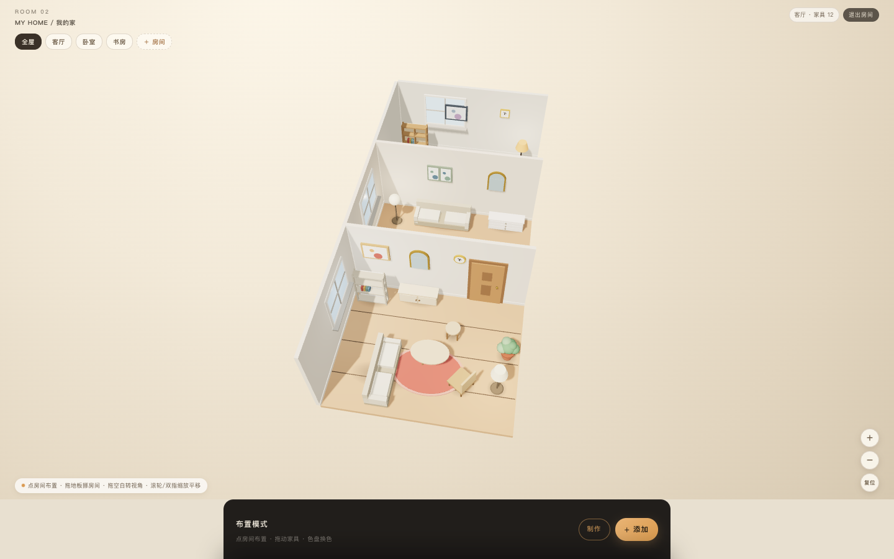
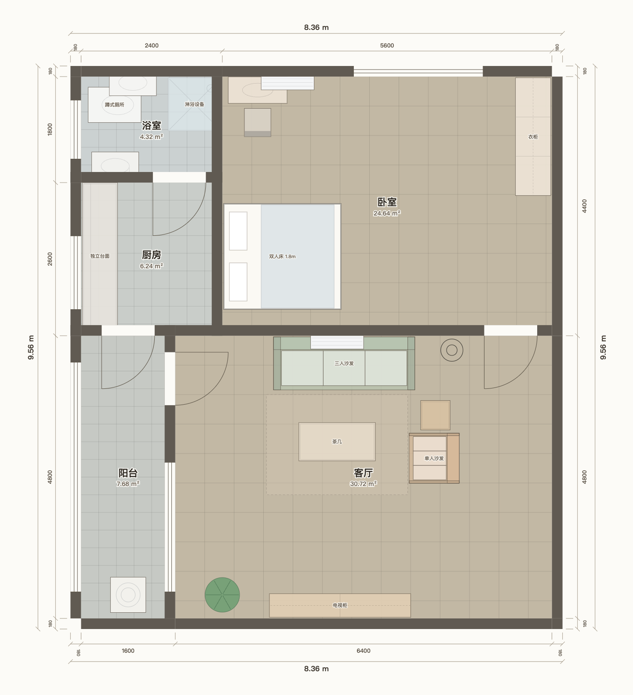

# RoomCraft · 房间工坊

[English](README.en.md) | 简体中文

[](https://taro.zone/)
[](https://threejs.org/)
[](./LICENSE)

一款基于 **Taro + three.js** 的 3D 房间布置小游戏 Demo：构建为 H5 网页，并保留 App(RN) 构建配置。从一间空房开始，加房间、改户型、铺地面、摆家具、给每件东西换色，顺手做一件只属于你的家具，最后导出 2D 平面图或整本 PDF。

所有房间、家具、门窗与材质均由代码实时生成，**不依赖任何外部图片或版权素材**。



<!-- 部署后替换成你的在线地址 -->
<!-- 在线体验：https://<username>.github.io/roomcraft/ -->

## 功能特性

### 户型与房间

- 多房间户型：顶部标签切换、添加、改名、删除（二次确认，至少保留一间），房间多时标签行可横向滚动。
- 全屋视角下直接拖动房间地板即可挪动房间：0.25 m 网格吸附，靠近邻房时自动贴边，松手时若脱离主体则自动回弹。
- 房间尺寸支持 `6×4 / 8×6 / 9×7 / 10×5 / 12×8` 预设或自定义宽 / 深（1–20 m）。改尺寸后家具自动收回范围内，放不下的门窗会提示并移除，相邻房间自动让位并重新拼紧。

### 3D 场景

- three.js + WebGL 实时渲染，大厅推门进入、右上角退出。
- 环绕旋转、滚轮 / 双指缩放、双指拖动或右键（`Shift` + 拖动）平移，右侧按钮可缩放与复位。
- 桌面与手机布局自适应，触屏手势完整支持。
- 内置中 / 英双语：HUD 右上角 `EN / 中文` 一键切换，偏好保存在本地，2D 平面图与 PDF 导出同步切换。

### 装修与家具

- 墙面、地板、踢脚线、门、窗均可选中换色；48 色统一色盘，自动派生整套明暗配色。
- 墙面 / 地板支持**素面、瓷砖、木板**铺装，砖尺寸、板宽可调。
- 门窗可贴墙移动，宽 / 高通过滑杆按米调节。
- 内置 [floorplan-3d](https://github.com/wy51ai/floorplan-3d) 家具库，家具按房间自动落位。
- 家具支持拖动、X/Y/Z 三轴旋转、宽 / 深 / 离地高度按米调节，可换色、删除。
- 撤销最近 30 步操作。

### DIY 家具工坊

- 用方块、圆柱、圆球、圆锥自由拼出一件家具，调尺寸、颜色并命名。
- 作品库存放在 `localStorage`，支持导出 / 导入作品库分享码，可多件累积使用。

### 导出与分享

- **分享码**：`MYHOME1:` + base64url(deflate(JSON))，压缩失败时降级为未压缩的 `MYHOME0:`。
- **分享包**：zip 文件，内含分享码文本与预览图，对方粘贴分享码即可还原整个家。
- **2D 平面布置图**：含房间名称与面积、家具名称、门窗图例、四边尺寸链，作为分享包预览图与 PDF 首页输出（PNG）。
- **PDF 方案册**：2D 平面图 + 3D 正俯视 + 每个房间一页 3D 全景，内置最小 PDF 生成器，不依赖第三方 PDF 库。



## 技术栈

| 类别 | 选型 |
| --- | --- |
| 跨端框架 | Taro 4.3.2（React 18 + TypeScript） |
| 3D 渲染 | three.js 0.128 + WebGL |
| 压缩 / 分享码 | fflate（纯 JS deflate） |
| 样式 | Sass |
| 构建 | Webpack 5（Taro 内置） |

## 快速开始

环境要求：Node.js 18+（推荐 20 LTS）、npm 9+。

```bash
git clone https://github.com/<your-name>/roomcraft.git
cd roomcraft
npm install
npm run dev:h5
```

启动后打开 <http://localhost:10086>。

## 可用命令

| 命令 | 说明 | 产物 |
| --- | --- | --- |
| `npm run dev:h5` | H5 开发模式（watch） | 内存编译，端口 10086 |
| `npm run build:h5` | H5 生产构建 | `dist/` |
| `npm run build:h5:deploy` | H5 部署构建，输出到独立目录 | `dist-h5/` |
| `npm run build:h5:pages` | GitHub Pages 构建（含 SEO 收尾） | `dist-h5/` |
| `npm run dev:rn` | React Native 开发模式（未完善） | — |
| `npm run build:rn` | React Native 构建（未完善） | — |

> `build:h5:pages` 输出到 `dist-h5/`，与 `build:h5` 的 `dist/` 互不覆盖。

## 部署

### H5 / GitHub Pages

仓库内置 [deploy-pages.yml](.github/workflows/deploy-pages.yml)：推送到 `main` 分支（或手动触发 workflow）即可自动构建并发布到 GitHub Pages。

首次部署前，在仓库 **Settings → Pages → Build and deployment** 中把 **Source** 选为 **GitHub Actions**。

工作流会自动完成：

- 按仓库名生成 `TARO_PUBLIC_PATH`，适配 `https://<username>.github.io/<repo>/` 子路径；
- 注入 `SITE_URL`，替换 HTML 里 canonical、Open Graph、JSON-LD 的占位符；
- 生成 `robots.txt`、`sitemap.xml`、`.nojekyll`，并复制 `og-cover.png` 分享图。

本地验证生产产物：

```bash
TARO_PUBLIC_PATH=/roomcraft/ \
SITE_URL=https://<username>.github.io/roomcraft/ \
npm run build:h5:pages

npx serve dist-h5
```

H5 使用 hash 路由，静态托管无需额外的 404 回退。若仓库名为 `<username>.github.io`（用户主页），工作流会自动改用根路径。

### App / RN

RN 构建脚本已保留，但依赖与适配尚未接入，当前不可用。

## SEO

[src/index.html](src/index.html) 已内置面向搜索引擎与社交分享的元信息：

- `<title>`、`description`、`keywords`、`robots` 与 `lang="zh-CN"`；
- `canonical`、Open Graph、Twitter Card（构建时注入真实域名与分享图）；
- `WebApplication` JSON-LD 结构化数据；
- 无 JavaScript 时的 `<noscript>` 简介，以及内联 SVG favicon。

`npm run build:h5:pages` 会在产物中额外生成 `robots.txt`、`sitemap.xml` 和 `.nojekyll`。上线后可在 [Google Search Console](https://search.google.com/search-console) 与 [Bing Webmaster Tools](https://www.bing.com/webmasters) 提交 `sitemap.xml`，加速收录。单页应用的实际内容由 JavaScript 渲染，建议同时完善仓库简介与 Topics（如 `threejs`、`taro`、`3d`、`interior-design`、`room-planner`）提升 GitHub 搜索曝光。

## 目录结构

```
.
├── config/                          # Taro 构建配置（h5 / rn）
│   ├── index.ts
│   ├── dev.ts
│   └── prod.ts
├── src/
│   ├── app.ts
│   ├── app.config.ts                # 页面路由
│   ├── app.scss
│   ├── index.html
│   ├── i18n/                        # 中英词典与 DOM 实时翻译
│   └── pages/
│       └── scene/
│           ├── index.tsx            # 页面结构：大厅、HUD、房间标签、操作栏、仓库 / 工坊
│           ├── engine.ts            # 3D 场景引擎与全部交互逻辑（three.js）
│           ├── floorplanFurniture.ts # 家具库、模型与材质工厂
│           └── scene3d.scss         # 满屏自适应舞台样式
├── .github/workflows/deploy-pages.yml # GitHub Pages 自动部署
├── scripts/
│   └── seo-postbuild.mjs            # 注入 SITE_URL、生成 robots / sitemap / .nojekyll
├── .screenshots/                    # README 与 OG 分享图
└── package.json
```

## 交互速查

| 操作 | 效果 |
| --- | --- |
| 拖动空白处 / 单指拖动 | 环绕旋转视角 |
| 滚轮 / 双指捏合 | 缩放 |
| 双指拖动 / 右键拖动 / `Shift` + 拖动 | 平移画面 |
| 点击家具或结构元素 | 选中，底部操作栏可换色、调尺寸、移除 |
| 按住家具拖动 | 自由移动（自动限制在房间内） |
| 再次点击已选中的结构元素 | 取消选中 |
| `Esc` | 依次关闭分享卡 / 菜单 / 色盘 / 面板 / 取消选中 / 退出房间 |

## 分享码格式

```
MYHOME1:<base64url(deflate(JSON))>   # 压缩版
MYHOME0:<base64url(JSON)>            # 未压缩兜底
```

导入时兼容空行、引号、全角冒号以及夹带说明文字的内容，会自动提取分享码。

## 已知限制

- 布置数据只保存在当前页面内，刷新后不保留（DIY 作品库除外，存于 `localStorage`）。
- RN 端脚本保留，但依赖未接入、未做验证。
- `src/pages/scene/engine.ts` 由早期单文件 Demo 迁移而来，顶部暂时保留 `@ts-nocheck`。

## 贡献

欢迎提交 Issue 和 Pull Request：

1. Fork 本仓库并创建特性分支：`git checkout -b feat/your-feature`。
2. 保持代码风格与现有实现一致，新增家具请走 `floorplanFurniture.ts` 的工厂与目录。
3. 不引入外部图片素材，所有视觉元素尽量用代码生成。
4. 提交前至少执行一次 `npm run build:h5` 确认可构建。
5. 提 Issue 时请附上浏览器 / 设备、复现步骤和截图。

## License

本项目基于 [MIT License](./LICENSE) 开源。

## 致谢

- [Taro](https://taro.zone/) —— 跨端框架
- [three.js](https://threejs.org/) —— 3D 渲染
- [fflate](https://github.com/101arrowz/fflate) —— 纯 JS 压缩
- [floorplan-3d](https://github.com/wy51ai/floorplan-3d) —— 开源家具库与 3D 模型（MIT）
